<p align="center">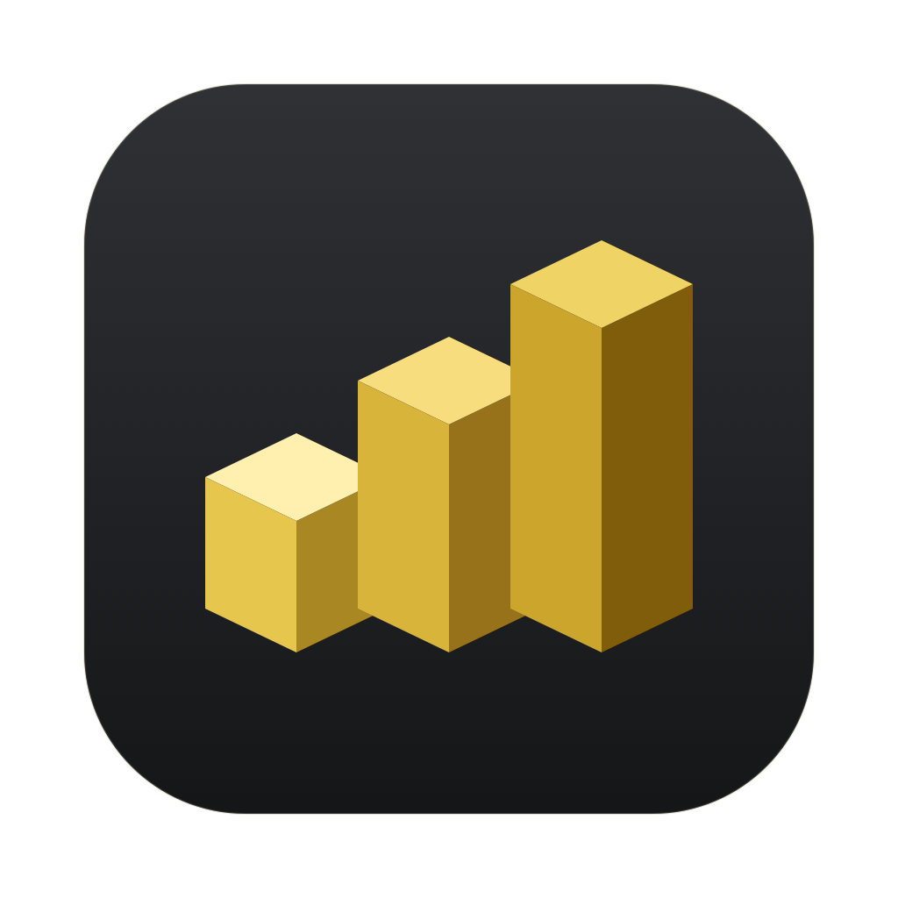</p>
<h1 align="center">MakerGlance</h1>
<p align="center"><strong>See what moved. Keep the history.</strong></p>
<p align="center">Your MakerWorld creator workspace, at home on the Mac.</p>
<!-- verified-badges:start -->
<p align="center">
<a href="#build--try-it">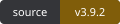</a>
<a href="docs/LOCAL_VALIDATION.json">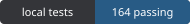</a>
<a href="docs/LOCAL_VALIDATION.json">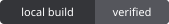</a>
<a href="#build--try-it">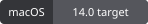</a>
<a href="Package.swift">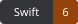</a>
<a href="LICENSE">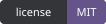</a>
</p>
<!-- verified-badges:end -->
<p align="center"><a href="#what-you-can-do">Features</a> · <a href="#see-it-in-action">Watch the demos</a> · <a href="#build--try-it">Build & try it</a> · <a href="docs/PRIVACY.md">Privacy</a></p>

**A native Mac dashboard for MakerWorld creators.** Follow your models' performance, see which designs are gaining attention, review available rewards and revisit your own cloud print history in one workspace.

**See what changed since the last check and which models are growing today.** MakerGlance keeps a local record of your observations, lets you rank the changes that matter to you, and brings selected updates to the menu bar and macOS notifications while it is running.

<picture>
  <source media="(prefers-color-scheme: light)" srcset="docs/media/overview-light.png">
  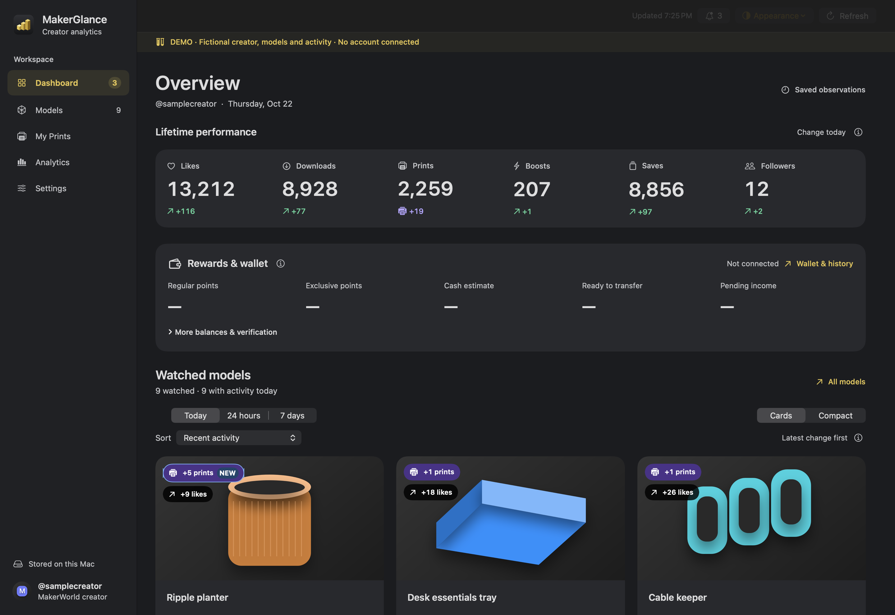
</picture>

*Native app views with fictional demo data and original artwork. [See the full dashboard](docs/media/dashboard-full-dark.png).*

## What you can do

| Workspace | What it helps you do |
| --- | --- |
| **Model performance** | Track likes, downloads, prints, boosts and saves. Compare lifetime totals with observed gains for Today, 24 hours or seven days; sort watched models and switch between Cards and Compact. |
| **Trends & reports** | Review your local observation history and available Creator Center period reports, with local-day growth kept separate from server UTC reports. |
| **Activity & alerts** | Follow selected model changes, milestones, new followers and supported account activity. Choose notification categories, pause individual model alerts, mark updates read or clear the local inbox. |
| **Followers** | Search and sort your community, see when new followers were first observed, and open an identified single follower's MakerWorld profile from its activity entry. |
| **Points & wallet** | Keep regular points, exclusive points, cash-redemption estimates and wallet funds distinct. Review supplied transaction reasons and model context where available. |
| **My Prints** | Find your own recorded cloud jobs by model, printer or plate. Filter by status and date, sort the history, and open supplied job details. |
| **Desktop workflow** | Check totals and unread activity from the menu bar with the main window closed. Choose System, Light or Dark appearance, adjust text size and set your refresh interval. |

**Choose how to start.** Enter your own numeric MakerWorld user ID for public profile, model and follower monitoring. Connect your own Bambu account to add supported private inbox activity, rewards, wallet observations, Creator Center reports and My Prints. You can explore the offline demo without connecting an account.

Local history grows from the observations MakerGlance actually collects. Alerts use polling while the app runs; quitting or sleeping pauses checks. Private features depend on the data exposed by the connected service. The app provides monitoring and history; publishing, printer commands and financial transactions stay outside its scope.

## Take the visual tour

[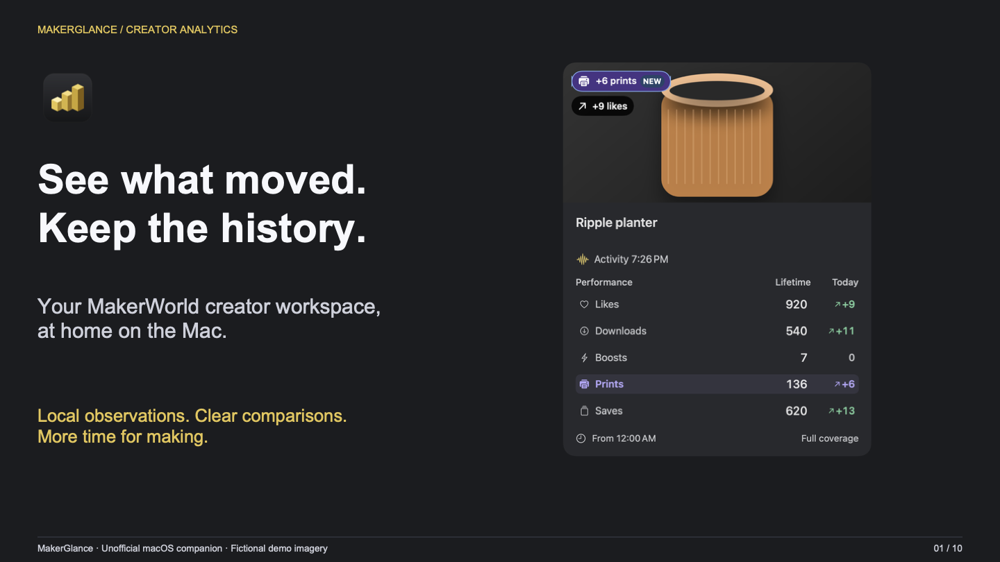](docs/presentation/MakerGlance.pdf)

**[Open the 10-slide PDF](docs/presentation/MakerGlance.pdf)** · [Editable PowerPoint](docs/presentation/MakerGlance.pptx) · [Accessible text transcript](docs/presentation/transcript.md)

All images below show **real native app views with fictional offline observations and original model artwork**. No live balances, private messages or account identities are pictured. Demos are focused at readable sizes; full workspace images are linked separately.

## See it in action

### 01 · One watchlist. Two ways to scan it.

<picture>
  <source media="(prefers-reduced-motion: reduce)" srcset="docs/media/cards-compact-poster.png">
  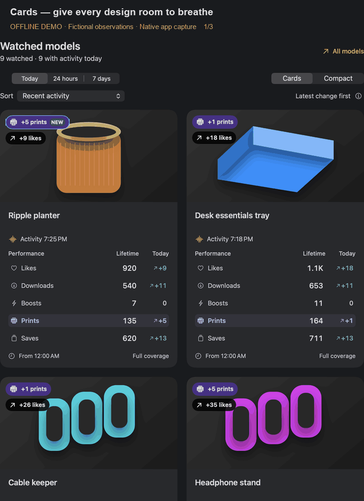
</picture>

**Cards** puts the model imagery first. **Compact** shows more models at once. Both preserve the same observations, growth window and actions. Choose **recent activity, prints, saves, boosts, downloads or likes**, then rank by **lifetime totals or gains in Today / 24 hours / 7 days**. The layout and sort choices are saved locally; missing data stays unknown. Range and sort changes apply immediately to the local observations. Lifetime totals stay fixed when you change the growth window; ranges can legitimately match when their available observations overlap.

[Static view](docs/media/cards-compact-poster.png) · [Full Cards screenshot](docs/media/cards-dark.png) · [Full Compact screenshot](docs/media/compact-dark.png)

### 02 · Spot print growth. See what changed.

<picture>
  <source media="(prefers-reduced-motion: reduce)" srcset="docs/media/print-check-poster.png">
  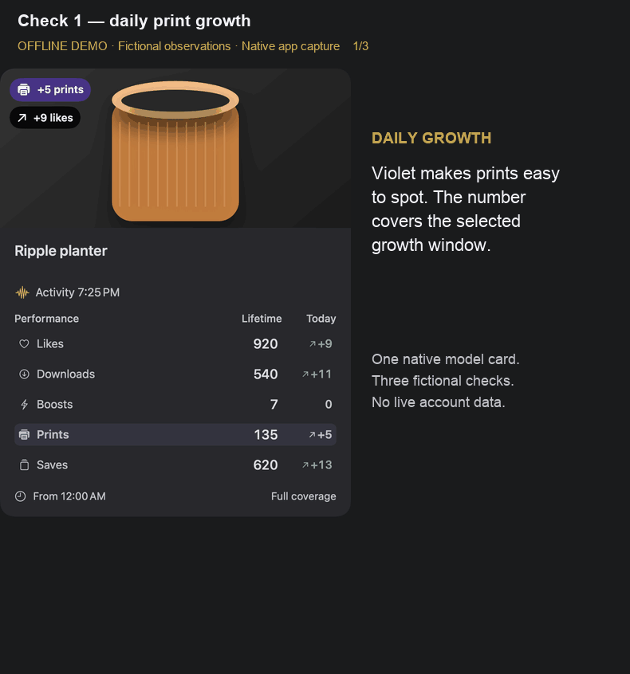
</picture>

**Violet prints** brings print growth forward. **Blue NEW** means that metric increased in the latest successful comparable check. The next unchanged check clears NEW; it keeps the daily total. Hover in the app for the separate check-to-check increase and both timestamps.

[Static view](docs/media/print-check-poster.png). This guided demo replays fictional observations through the real comparison logic; it is not a live service recording. First imports and failed checks never manufacture growth.

### 03 · See the trends together.

<picture>
  <source media="(prefers-reduced-motion: reduce)" srcset="docs/media/history-range-poster.png">
  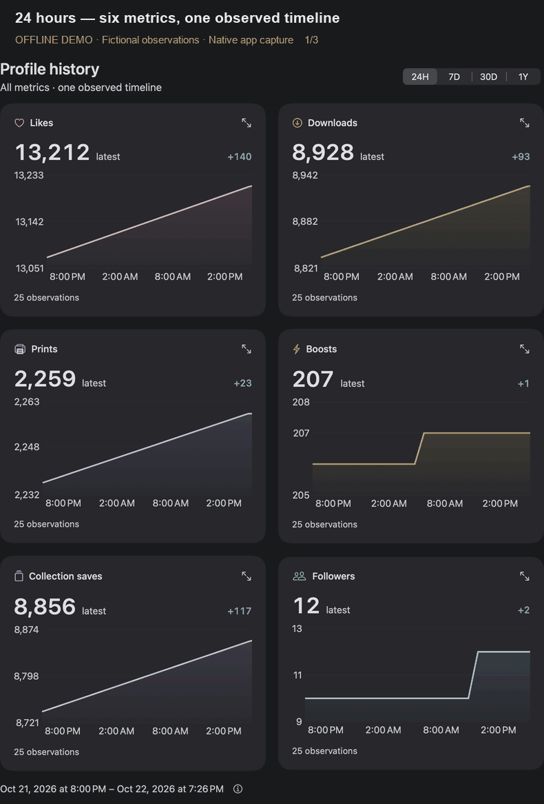
</picture>

Likes, downloads, prints, boosts, saves and followers stay visible together. Change the range once and compare the charts side by side, each with its own scale.

[Static view](docs/media/history-range-poster.png) · [Full history screenshot](docs/media/history-dark.png)

### 04 · Your own prints, in one native history.

[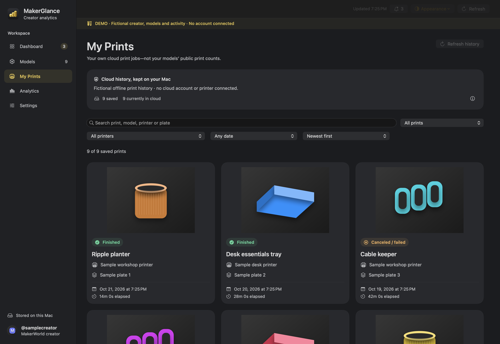](docs/media/my-prints-dark.png)

Find a past cloud job by model, printer or plate. Filter by status, printer and date, or sort by newest, oldest and recorded elapsed time. Open a print for its supplied details. **Your jobs stay separate from your models’ public print totals.**

The existing authorized Bambu connection supplies the read-only task feed; no Studio credentials or plugin are imported. Stable task IDs update local records across refreshes and restarts. A failed crawl preserves saved history. Stopped records remain **Canceled / failed** when the service does not distinguish the cause; elapsed timestamps and slice estimates stay separate. Offline/LAN-only or older jobs absent from the cloud cannot be reconstructed.

[Light appearance](docs/media/my-prints-light.png) · [History and coverage details](docs/INTEGRATION.md#my-prints)

**Keep the clocks clear.** Dashboard **Today** follows your Mac's local midnight-to-midnight calendar day, starting at the first actual observation with partial coverage labeled. **24 hours / 7 days** are rolling growth windows. Available Creator Center reports keep their server **UTC+0** dates separate. No missing midnight value or chart gap is invented.

### 05 · Keep context in your desktop workflow.

[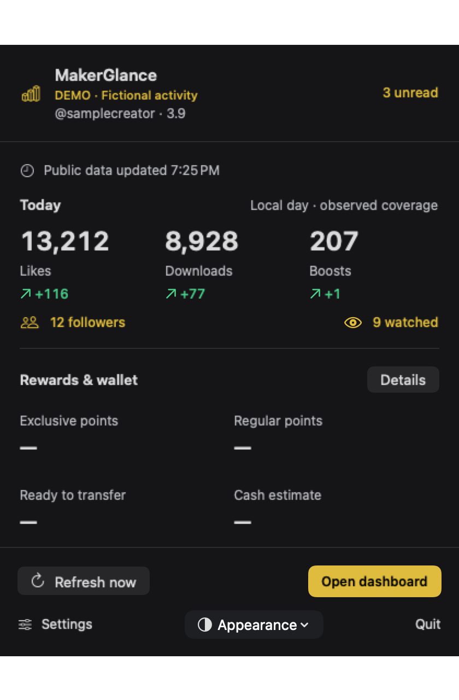](docs/media/menu-dark.png)

**Your studio, a click away.** Scan unread activity, refresh or jump back into a model while the main window is closed. The menu keeps last-success freshness visible; unavailable account balances remain explicit.

[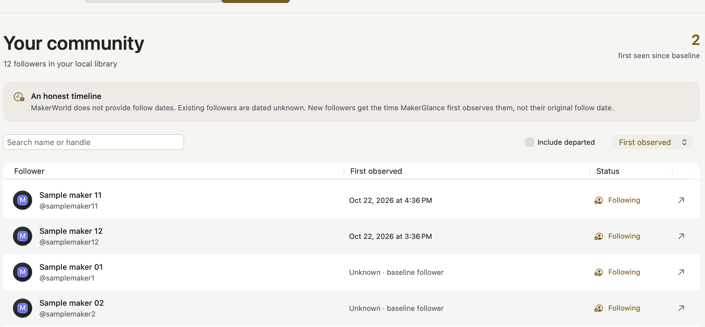](docs/media/followers-light.png)

**A useful first-seen timeline.** Search and sort followers. Existing accounts stay date unknown; new observations get a persistent first-seen time, never a guessed original follow date.

Identified single-follower entries in Activity, the dashboard or the tray open that person's MakerWorld profile in your browser, including saved entries with a known identity. Grouped updates remain summaries. The tray has **Mark all read** beside its unread count; Activity also supports clearing individual updates or the inbox. These actions stay local. Choose notification categories in Settings; printer/device updates are off by default.

All models, including newly discovered ones, start watched. Models has working All / Watched / Paused filters and individual alert choices. Pausing alerts keeps observations. The initial import is quiet; persistent milestone high-water marks and event IDs prevent repeated alerts.

**Make it yours:** System / Light / Dark appearance, persistent Cards / Compact choice, **85–150% Text Size**, and refresh intervals from 5 minutes to 24 hours, including 10 minutes. Larger text wraps instead of scaling the whole window.

<details><summary><strong>Connected account features and notification limits</strong></summary>

A valid session can load exposed comments, replies, mentions and other supported account activity, points, wallet observations and Creator Center reports. Marking activity read changes this app's local state only.

Regular points, exclusive points, the server cash-redemption estimate, ready-to-transfer wallet cash and pending income stay distinct, preserving currency and decimal precision. Point activity shows supplied incentive reasons, model context and boost donors where exposed. Balance changes are reconciled with supporting ledger entries; ambiguous or delayed details remain pending rather than guessed. There are no redemption, withdrawal or transfer actions.

Notifications are local polling notifications requiring macOS permission. Monitoring continues with the main window closed while the app is running. Quitting or sleeping pauses checks. Profile milestones cover exposed counts; model alerts cover boosts, likes, downloads and aggregate saves. Print emphasis is visual, not a promise of individual print-event notifications. Aggregate saves do not identify individual collections.

Requests use bounded pagination, deduplication, pacing and transient backoff. Incomplete crawls preserve the last complete baseline. Undocumented services can change or reject a native session. See [integration and limitations](docs/INTEGRATION.md).
</details>

**A companion to MakerWorld.** Profile totals and some reports overlap with the website. MakerGlance brings local observation history, latest-check comparisons, your monitoring choices and native desktop actions into one workspace. The official website remains the place to publish and use its creator tools; this is not an official analytics API or a replacement for every website feature.

## Build & try it

Source preview · **Build locally. No public binary release or notarized download is advertised.**

```sh
git clone https://github.com/t0nyz0/MakerGlance.git
cd MakerGlance
swift test
bash scripts/build.sh
open dist/MakerGlance.app
```

To look around before connecting an account, quit MakerGlance and launch the isolated fictional demo:

```sh
open -n dist/MakerGlance.app --args --demo
```

**Requirements:** macOS 14+ deployment target, Swift 6 and Xcode 16+. Current validation uses Apple Silicon, macOS 27.0.1, Xcode 27.1 and Swift 6.4; Intel and the oldest supported macOS remain unverified. No third-party Swift package is required; SQLite comes from macOS. The script creates an optimized, locally **ad-hoc signed** app, not a Developer ID signed or notarized distribution. It does not change Gatekeeper or system security settings.

<details><summary><strong>First launch and local installation</strong></summary>

Settings asks you to choose your own creator profile: connect using the available email-code/MFA or own-session flow, or enter its numeric public user ID. One library monitors one creator; an existing history is not silently reassigned. Sessions are validated against that creator and stored in Keychain.

```sh
mkdir -p "$HOME/Applications"
ditto dist/MakerGlance.app "$HOME/Applications/MakerGlance.app"
open "$HOME/Applications/MakerGlance.app"
```

The offline demo uses original fictional fixtures/artwork and a separate temporary library. It does not read the live library or Keychain, connect an account, poll live services or send notifications. The README GIFs use these same native views. [Capture and media provenance](docs/media/README.md).
</details>

## Privacy, trust & current limits

History stays in local SQLite; sessions stay in Keychain. Requests go to Bambu/MakerWorld services and approved image CDNs. No app analytics SDK or developer-operated data service is present. Local history is **not encrypted by the app**. The legacy bundle/Keychain identifier and `MakerPulse` support-directory name preserve existing installations.

[Preview download notes](docs/DOWNLOADS.md) · [Privacy & storage](docs/PRIVACY.md) · [Security policy](SECURITY.md) · [Review findings](docs/SECURITY_REVIEW.md) · [Release readiness](docs/RELEASE_READINESS.md)

Publication uses a clean source snapshot; the original private development history is kept separately. See the [publication review](docs/PUBLICATION_REVIEW.md) for validation and the approval boundary. These checks reduce risk without providing a security guarantee.

**Unofficial project.** MakerGlance is not affiliated with, endorsed by or sponsored by Bambu Lab or MakerWorld. Undocumented services have no access, availability or schema guarantee.

**Third-party rights.** MakerWorld and Bambu Lab names, logos and trademarks belong to their respective owners. Model designs, images and other third-party content remain the property of their respective rights holders, subject to their applicable licenses and terms. All rights in those materials remain with their owners. MakerGlance's [MIT license](LICENSE) covers this project's original code and assets; it grants no rights to third-party trademarks or content.

## The complete workspace

[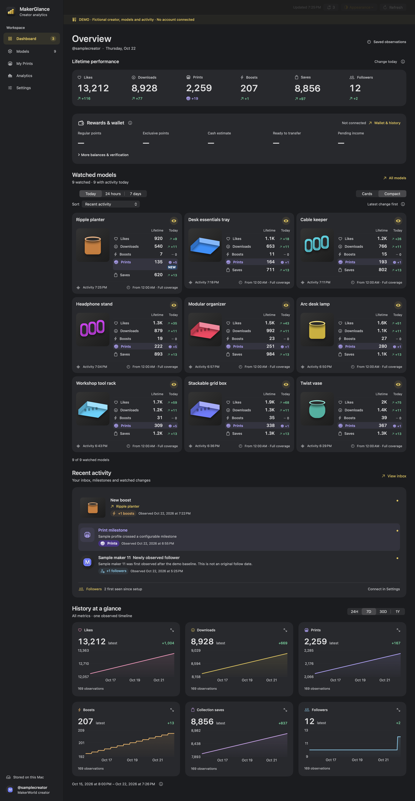](docs/media/dashboard-full-dark.png)

**Nothing hidden below the fold.** This uncropped overview shows the entire Dashboard; click for full resolution. [Light appearance](docs/media/dashboard-full-light.png) · [Full Cards](docs/media/cards-dark.png) · [Full Compact](docs/media/compact-dark.png). The focused demos above preserve readable detail at normal README width.

[Contribute](CONTRIBUTING.md) · [MIT license](LICENSE) © [t0nyz0](https://github.com/t0nyz0)
