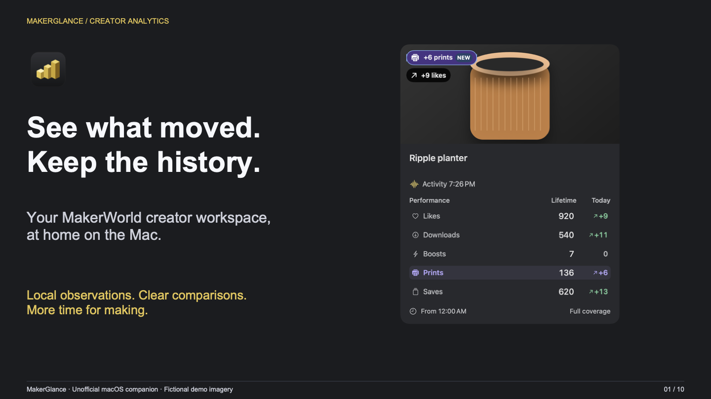

# MakerGlance presentation

[Read the PDF](MakerGlance.pdf) · [Edit the PowerPoint](MakerGlance.pptx) · [Read the transcript](transcript.md)

[](MakerGlance.pdf)

Ten slides tell the creator workflow story: observe, compare and prioritize; distinguish print growth from the latest check; choose Cards or Compact; revisit private My Prints history; build local history; keep follower dates honest; and stay in a native desktop workflow. Website overlap and service limits are explicit.

All screenshots come from the app's offline demo. Identities, model artwork and observations are fictional. No account balances, private inbox content, credentials or real follower identities are included. See [media provenance](../media/README.md).

## Edit or rebuild

The PowerPoint contains editable text and shapes, embedded screenshots, picture alternative text and speaker notes. It has no macros, embedded account data or external image links. The declarative source is [build.py](build.py).

```sh
python3 -m venv .venv-deck
.venv-deck/bin/pip install -r docs/presentation/requirements.txt
.venv-deck/bin/python docs/presentation/build.py
.venv-deck/bin/python docs/presentation/verify.py
python3 scripts/check_documentation.py
```

These are documentation-only dependencies; they are not part of the Swift app. The builder uses Arial from macOS or DejaVu Sans from a standard Linux font installation. PowerPoint text uses Arial with the viewer's font substitution as needed. Re-render after edits, especially when changing fonts.

## Accessibility and verification

The PDF has selectable text, embedded fonts, English document language, a document title, headings, marked reading-order structure and alternative text for figures. The PowerPoint has editable text, English language metadata, alternative text on pictures and a matching plain-text transcript. Color is reinforced with labels and explanations.

All ten PDF pages were rendered with native PDFKit and visually checked for overflow, contrast, screenshot cropping and content. Structural checks verify ten pages/slides, figure descriptions, PDF tags, metadata and the absence of external PowerPoint relationships. These checks do **not** establish PDF/UA conformance or verify every screen reader / PowerPoint viewer. The transcript is provided as an additional reading format. PDF and PPTX are generated separately from the same layout source; the PPTX has not been opened in Microsoft PowerPoint here.

The presentation describes the private source preview. It does not advertise a public download, notarization or guaranteed access to undocumented services.
